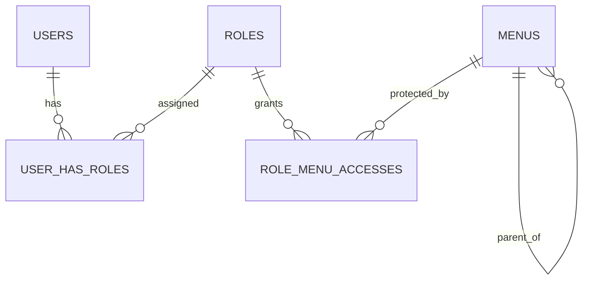

# Database Schema

> Project: `[PROJECT_NAME]`  
> Database: `PostgreSQL`  
> Updated: `[YYYY-MM-DD]`

## 1. Database principles

- PostgreSQL adalah default.
- Migration adalah source of truth perubahan schema.
- Business invariant penting sebaiknya memiliki constraint database jika praktis.
- Jangan menganggap database production kosong.
- Index dibuat berdasarkan query nyata.
- Hindari duplicate source of truth.
- Foreign key digunakan jika integritas relasi memang diperlukan.

## 2. ERD



## 3. Table catalog

| Table | Purpose | Model | Soft delete |
|---|---|---|---:|
| `users` | user aplikasi, login dengan NIK | `User` | No |
| `menus` | master menu sidebar + kunci permission | `Menu` | No |
| `roles` | master role (Administrator, dst.) | `Role` | No |
| `user_has_roles` | pivot user <-> role (many-to-many) | - | No |
| `role_menu_accesses` | hak action per role per menu | `RoleMenuAccess` | No |
| `activity_log` | audit log (spatie/laravel-activitylog v5), read-only dari aplikasi | `Spatie\Activitylog\Models\Activity` | No |

## 4. Table definition

### `users`

| Column | PostgreSQL type | Nullable | Default | Constraint/Note |
|---|---|---:|---|---|
| `id` | bigint | No | identity | PK |
| `nik` | varchar(30) | No | - | UNIQUE, dipakai untuk login |
| `name` | varchar(255) | No | - | |
| `email` | varchar(255) | No | - | UNIQUE |
| `password` | varchar(255) | No | - | hashed |
| `created_at` | timestamp | Yes | - | |
| `updated_at` | timestamp | Yes | - | |

`nik` ditambahkan langsung NOT NULL karena tabel `users` masih kosong saat migration dibuat.

### `menus`

| Column | PostgreSQL type | Nullable | Default | Constraint/Note |
|---|---|---:|---|---|
| `id` | bigint | No | identity | PK |
| `parent_id` | bigint | Yes | - | FK `menus.id`, RESTRICT |
| `code` | varchar(50) | No | - | UNIQUE, alpha_dash tanpa titik; kunci permission `{code}.{action}` |
| `title` | varchar(100) | No | - | |
| `icon` | varchar(100) | Yes | - | class boxicons |
| `route` | varchar(150) | Yes | - | nama route; kosong = menu grup |
| `sort_order` | integer | No | 0 | |
| `is_active` | boolean | No | true | nonaktif = disembunyikan dari sidebar |
| `created_at` | timestamp | Yes | - | |
| `updated_at` | timestamp | Yes | - | |

### `roles`

| Column | PostgreSQL type | Nullable | Default | Constraint/Note |
|---|---|---:|---|---|
| `id` | bigint | No | identity | PK |
| `name` | varchar(100) | No | - | UNIQUE |
| `description` | varchar(255) | Yes | - | |
| `created_at` | timestamp | Yes | - | |
| `updated_at` | timestamp | Yes | - | |

### `user_has_roles`

| Column | PostgreSQL type | Nullable | Default | Constraint/Note |
|---|---|---:|---|---|
| `user_id` | bigint | No | - | PK, FK `users.id` CASCADE |
| `role_id` | bigint | No | - | PK, FK `roles.id` RESTRICT |

### `role_menu_accesses`

| Column | PostgreSQL type | Nullable | Default | Constraint/Note |
|---|---|---:|---|---|
| `id` | bigint | No | identity | PK |
| `role_id` | bigint | No | - | FK `roles.id` CASCADE |
| `menu_id` | bigint | No | - | FK `menus.id` CASCADE |
| `can_create` | boolean | No | false | |
| `can_read` | boolean | No | false | juga menentukan menu tampil di sidebar |
| `can_update` | boolean | No | false | |
| `can_delete` | boolean | No | false | |
| `can_print` | boolean | No | false | |
| `can_approve` | boolean | No | false | |
| `created_at` | timestamp | Yes | - | |
| `updated_at` | timestamp | Yes | - | |

Tidak ada baris untuk pasangan role-menu = semua action `false`.
Hak akses user = hak akses **role aktif** saja. Role aktif disimpan di session
(`active_role_id`), dipilih saat login jika user punya lebih dari 1 role, dan bisa
diganti dari navbar tanpa login ulang (lihat middleware `ResolveActiveRole`).

### `activity_log`

| Column | PostgreSQL type | Nullable | Default | Constraint/Note |
|---|---|---:|---|---|
| `id` | bigint | No | identity | PK |
| `log_name` | varchar(255) | Yes | - | INDEX; `auth` / `data` / `security` |
| `description` | text | No | - | |
| `subject_type`, `subject_id` | varchar, bigint | Yes | - | morph ke objek yang terdampak |
| `event` | varchar(255) | Yes | - | `created`, `updated`, `login_failed`, `role_switched`, ... |
| `causer_type`, `causer_id` | varchar, bigint | Yes | - | morph ke pelaku (user); null = sistem/tamu |
| `attribute_changes` | json | Yes | - | `{ old: {...}, attributes: {...} }` |
| `properties` | json | Yes | - | ip, user_agent, nik (login gagal), dsb. |
| `created_at` | timestamp | Yes | - | INDEX (filter tanggal) |
| `updated_at` | timestamp | Yes | - | |

Tidak ada FK ke `users` agar jejak tetap ada meski user dihapus. Password/token tidak pernah disimpan.

## 5. Relationship

| Parent | Child | Type | Foreign key | On delete |
|---|---|---|---|---|
| `menus` | `menus` | 1:N | `menus.parent_id` | RESTRICT (hapus/pindahkan sub menu dulu) |
| `users` | `user_has_roles` | 1:N | `user_has_roles.user_id` | CASCADE |
| `roles` | `user_has_roles` | 1:N | `user_has_roles.role_id` | RESTRICT (role yang dipakai tidak bisa dihapus) |
| `roles` | `role_menu_accesses` | 1:N | `role_menu_accesses.role_id` | CASCADE |
| `menus` | `role_menu_accesses` | 1:N | `role_menu_accesses.menu_id` | CASCADE |

Jangan memilih cascade delete tanpa mempertimbangkan history/audit.

## 6. Index

| Table | Columns | Type | Query pattern |
|---|---|---|---|
| `menus` | `parent_id, sort_order` | btree | susun pohon menu terurut |
| `user_has_roles` | `role_id` | btree | cek role dipakai user / daftar user per role |
| `role_menu_accesses` | `role_id, menu_id` | unique | hak akses per role (cek permission) |
| `role_menu_accesses` | `menu_id` | btree | FK lookup saat menu dihapus |

Index harus punya alasan yang dapat dijelaskan.

## 7. Constraint

| ID | Table | Constraint | Reason |
|---|---|---|---|
| DBR-001 | `users` | UNIQUE `nik` | NIK identitas login |
| DBR-002 | `menus` | UNIQUE `code` | kunci permission harus unik |
| DBR-003 | `roles` | UNIQUE `name` | |
| DBR-004 | `role_menu_accesses` | UNIQUE `role_id, menu_id` | satu baris akses per role per menu |

## 8. Legacy mapping

Bagian ini wajib jika project merupakan rebuild/migrasi sistem lama.

| Legacy table.column | New table.column | Action | Reason |
|---|---|---|---|
| `[old]` | `[new]` | Rename/Keep/Remove/Merge/Split | `[reason]` |

Contoh:

```text
legacy typo column
    -> rename

unused column
    -> remove

2 redundant columns
    -> merge into one normalized field
```

## 9. Migration rules

### Penambahan column wajib pada data existing

```text
1. Add nullable/safe default
2. Deploy compatible application
3. Backfill
4. Validate
5. Enforce NOT NULL/constraint
```

### Rename/drop

Untuk production, pertimbangkan compatibility window jika aplikasi lama masih berjalan.

## 10. Migration example

```php
Schema::create('purchase_requests', function (Blueprint $table) {
    $table->id();
    $table->foreignId('requested_by')
        ->constrained('users')
        ->restrictOnDelete();
    $table->string('status', 30)->default('draft');
    $table->text('notes')->nullable();
    $table->timestamps();

    $table->index(['requested_by', 'status']);
});
```

Sesuaikan dengan schema sebenarnya.

## 11. Data migration

Jika migration membutuhkan transformasi data, dokumentasikan:

- sumber;
- target;
- mapping;
- jumlah row perkiraan;
- strategy backfill;
- validasi;
- rollback/mitigasi.

## 12. Seeders/factories

- Factory untuk test/development.
- Seeder master/reference data harus idempotent jika memungkinkan.
- Jangan memasukkan data production privat.
- Jangan memasukkan secret asli.

## 13. Sensitive data

| Table.Column | Classification | Encryption/Hash | Log | API |
|---|---|---|---|---|
| `users.password` | Secret | hash | No | Never |
| `[column]` | `[class]` | `[rule]` | `[rule]` | `[rule]` |

## 14. Schema checklist

- [ ] Semua table punya tujuan jelas.
- [ ] Relationship sudah ditentukan.
- [ ] Index berdasarkan query nyata.
- [ ] Constraint penting sudah ditentukan.
- [ ] Tidak ada duplicate source of truth tanpa alasan.
- [ ] Legacy mapping sudah ditulis jika migrasi.
- [ ] Migration aman untuk data existing.
