# Database Schema

> Project: `E-DPL Rebuild`  
> Database: `PostgreSQL`  
> Updated: `2026-10-06`

## 1. Database principles

- PostgreSQL adalah target database baru.
- Migration adalah source of truth perubahan schema.
- Schema baru mengikuti domain E-DPL, bukan copy MySQL/MariaDB legacy 1:1.
- Business invariant penting memiliki constraint database jika praktis.
- Jangan menganggap database production kosong pada fase migrasi/cutover.
- Index dibuat berdasarkan query nyata.
- Hindari duplicate source of truth.
- Foreign key digunakan jika integritas relasi memang diperlukan.
- Internal relational key memakai `bigint id`; business code/NIK tidak menjadi PK.
- Boolean memakai `boolean`, bukan `tinyint`.
- Financial/commercial calculation memakai `numeric/decimal`, bukan float/double.
- Tanggal bisnis tanpa jam menggunakan `date`.
- Event timestamp menggunakan timestamp Laravel/PostgreSQL yang konsisten; future phase dapat menstandardisasi timezone-aware timestamp jika dibutuhkan seluruh project.
- Historical DPL/approval tidak boleh terhapus karena cascade dari master data.
- `activity_log` (Spatie) tetap menjadi audit teknis/data. Business history menggunakan tabel domain.
- PostgreSQL schema dipisahkan **per sistem**:
  - `public`: master bersama lintas sistem (CRM/EBU/E-DPL) — identity & access (`users`, `roles`, `user_has_roles`, `menus`, `role_menu_accesses`, `activity_log`), organization (`sales_*`, `user_org_assignments`, `user_area_scopes`, `user_visibility_edges`), outlet master, `products`, `distributors`, `distributor_regions`, serta tabel framework (cache, jobs, sessions, pulse, migrations).
  - `dpl`: transaksi dan aturan milik E-DPL — Commercial, DPL core, Approval, dan Documents (lihat bagian 3).
  - Sistem berikutnya (EBU/CRM) memakai schema sendiri untuk transaksinya.
- Tabel schema sistem ditulis qualified (`dpl.dpl_proposals`) di migration/model/query; nama tabel tidak berubah saat dipindah schema.
- Struktur kode mengikuti schema: model `public` di `App\Models`, model schema `dpl` di `App\Models\Dpl` (factory di `Database\Factories\Dpl`), migration per domain di `database/migrations/{domain}`. Sistem berikutnya mengikuti pola yang sama (mis. `App\Models\Ebu`).
- `database.connections.pgsql.search_path` = `public,dpl`; setiap schema sistem baru wajib ditambahkan agar ikut di-wipe oleh `migrate:fresh`/`db:wipe`.
- Master di `public` tidak bergantung pada schema sistem. Data milik sistem tentang master (mis. region harga outlet untuk DPL) disimpan sebagai mapping di schema sistem tersebut (`dpl.outlet_price_regions`).
- Test memakai PostgreSQL lokal (`edpl_testing`) karena SQLite tidak mendukung schema.

## 2. Target ERD - high level

```mermaid
erDiagram
    USERS ||--o{ USER_HAS_ROLES : has
    ROLES ||--o{ USER_HAS_ROLES : assigned
    ROLES ||--o{ ROLE_MENU_ACCESSES : grants
    MENUS ||--o{ ROLE_MENU_ACCESSES : protected_by
    MENUS ||--o{ MENUS : parent_of

    SALES_ZONES ||--o{ SALES_REGIONS : contains
    SALES_REGIONS ||--o{ SALES_AREAS : contains
    USERS ||--o{ USER_ORG_ASSIGNMENTS : assigned
    SALES_AREAS ||--o{ USER_ORG_ASSIGNMENTS : scopes

    OUTLET_CATEGORIES ||--o{ OUTLETS : classifies
    OWNERSHIP_TYPES ||--o{ OUTLETS : owns
    SALES_AREAS ||--o{ OUTLETS : located_in
    OUTLET_GROUPS ||--o{ OUTLET_GROUP_MEMBERS : contains
    OUTLETS ||--o{ OUTLET_GROUP_MEMBERS : member

    PRODUCTS ||--o{ PRODUCT_PRICES : priced
    PRICE_REGIONS ||--o{ PRODUCT_PRICES : defines
    DISTRIBUTORS ||--o{ DISTRIBUTORS : parent_of

    OUTLETS ||--o{ DPL_PROPOSALS : receives
    USERS ||--o{ DPL_PROPOSALS : creates
    DPL_PROPOSALS ||--o{ DPL_ITEMS : contains
    PRODUCTS ||--o{ DPL_ITEMS : product
    DISTRIBUTORS ||--o{ DPL_ITEMS : distributor
    BONUS_SCHEMES ||--o{ DPL_ITEMS : bonus
    DPL_ITEMS ||--|| DPL_ITEM_TERMS : terms

    DPL_PROPOSALS ||--o{ DPL_REVISIONS : revisions
    DPL_PROPOSALS ||--o{ DPL_STATUS_HISTORIES : transitions
    DPL_PROPOSALS ||--o{ DPL_RELATIONS : source
    DPL_PROPOSALS ||--o{ DPL_RELATIONS : target

    APPROVAL_WORKFLOWS ||--o{ APPROVAL_WORKFLOW_STEPS : defines
    DPL_PROPOSALS ||--o{ APPROVAL_INSTANCES : executes
    APPROVAL_WORKFLOWS ||--o{ APPROVAL_INSTANCES : template
    APPROVAL_INSTANCES ||--o{ APPROVAL_STEP_INSTANCES : steps
    APPROVAL_WORKFLOW_STEPS ||--o{ APPROVAL_STEP_INSTANCES : snapshot_from
    APPROVAL_STEP_INSTANCES ||--o{ APPROVAL_STEP_ASSIGNEES : candidates
    USERS ||--o{ APPROVAL_STEP_ASSIGNEES : assigned
    APPROVAL_STEP_INSTANCES ||--o{ APPROVAL_ITEM_STATES : item_state
    DPL_ITEMS ||--o{ APPROVAL_ITEM_STATES : reviewed
    APPROVAL_STEP_INSTANCES ||--o{ APPROVAL_ACTIONS : events

    DPL_CONSOLIDATIONS ||--o{ DPL_CONSOLIDATION_OUTLETS : contains
    OUTLETS ||--o{ DPL_CONSOLIDATION_OUTLETS : member
    DPL_PROPOSALS ||--o| DPL_CONSOLIDATION_OUTLETS : generated

    DISTRIBUTORS ||--o{ DISTRIBUTOR_BRANCH_HEADS : branch_head
    DPL_PROPOSALS ||--o{ EXIT_LETTERS : source
    DISTRIBUTORS ||--o{ EXIT_LETTERS : addressed_to
```



## 3. Table catalog

### Existing foundation - keep/reuse

| Table | Purpose | Model | Soft delete |
|---|---|---|---:|
| `users` | canonical user aplikasi, login dengan NIK | `User` | No |
| `menus` | master menu sidebar + permission key | `Menu` | No |
| `roles` | master role | `Role` | No |
| `user_has_roles` | pivot user <-> role | - | No |
| `role_menu_accesses` | hak action per role per menu | `RoleMenuAccess` | No |
| `activity_log` | audit log Spatie | package model | No |
| `pulse_values`, `pulse_entries`, `pulse_aggregates` | Laravel Pulse | - | No |

### New E-DPL target

| Domain | Tables |
|---|---|
| Identity/Organization | `sales_zones`, `sales_regions`, `sales_areas`, `user_org_assignments`, `user_area_scopes`, `user_visibility_edges` |
| Outlet master | `outlet_categories`, `ownership_types`, `outlet_groups`, `outlet_group_members`, `outlets` |
| Product/Distributor master | `products`, `distributors`, `distributor_regions` |
| Commercial | `price_regions`, `product_prices`, `product_price_overrides`, `bonus_schemes`, `distributor_margin_rules`, `distributor_margin_overrides`, `commercial_parameters` |
| DPL core | `dpl_proposals`, `dpl_items`, `dpl_item_terms`, `dpl_status_histories`, `dpl_revisions`, `dpl_relations`, `dpl_consolidations`, `dpl_consolidation_outlets` |
| Approval | `approval_workflows`, `approval_workflow_steps`, `approver_assignments`, `approval_instances`, `approval_step_instances`, `approval_step_assignees`, `approval_item_states`, `approval_actions`, `approval_override_requests` |
| Documents | `distributor_branch_heads`, `exit_letters`, `attachments` |
| Reporting | fase terpisah: selling in/out/target target schema/tables TBD |

## 4. Existing foundation changes

### `users`

Existing fields remain. Target identity:

| Column | PostgreSQL type | Nullable | Default | Constraint/Note |
|---|---|---:|---|---|
| `id` | bigint | No | identity | PK, internal FK key |
| `uuid` | uuid | No | generated by application/migration strategy | UNIQUE, stable opaque integration/JWT identifier |
| `nik` | varchar(30) | No | - | UNIQUE, login + legacy mapping |
| `name` | varchar(255) | No | - | |
| `email` | varchar(255) | No | - | UNIQUE |
| `email_verified_at` | timestamp | Yes | - | existing |
| `last_login_at` | timestamp | Yes | - | waktu login terakhir |
| `password` | varchar(255) | No | - | hash only |
| `is_active` | boolean | No | true | status akun; user dinonaktifkan, bukan dihapus (FK domain RESTRICT) |
| `remember_token` | varchar(100) | Yes | - | existing Laravel |
| `created_at` | timestamp | Yes | - | |
| `updated_at` | timestamp | Yes | - | |

Rules:

- `users.id` digunakan oleh FK internal.
- NIK bukan PK.
- Future JWT `sub` menggunakan `users.uuid`; NIK boleh menjadi claim tambahan.
- `uuid` adalah UUID v4 acak, di-generate model `User` saat create; user existing di-backfill oleh migration (nullable -> backfill -> NOT NULL + UNIQUE).
- Sebelum legacy cutover, audit NIK null/blank/duplicate wajib dilakukan.
- Jangan mengubah password hash legacy tanpa migration strategy yang sudah dikonfirmasi.

Existing `roles`, `user_has_roles`, `menus`, `role_menu_accesses`, dan `activity_log` tetap mengikuti definition project saat ini.

## 5. Organization tables

### `sales_zones`

| Column | Type | Nullable | Constraint/Note |
|---|---|---:|---|
| `id` | bigint | No | PK |
| `code` | varchar(30) | No | UNIQUE |
| `name` | varchar(100) | No | |
| `is_active` | boolean | No | default true |
| timestamps | timestamp | Yes | Laravel timestamps |

### `sales_regions`

| Column | Type | Nullable | Constraint/Note |
|---|---|---:|---|
| `id` | bigint | No | PK |
| `code` | varchar(30) | No | UNIQUE |
| `name` | varchar(100) | No | |
| `zone_id` | bigint | No | FK `sales_zones.id`, RESTRICT |
| `is_active` | boolean | No | default true |
| timestamps | timestamp | Yes | |

Index: `zone_id`.

### `sales_areas`

| Column | Type | Nullable | Constraint/Note |
|---|---|---:|---|
| `id` | bigint | No | PK |
| `code` | varchar(30) | No | UNIQUE |
| `name` | varchar(100) | No | |
| `region_id` | bigint | No | FK `sales_regions.id`, RESTRICT |
| `is_active` | boolean | No | default true |
| timestamps | timestamp | Yes | |

Index: `region_id`.

### `user_org_assignments`

Menyimpan organization scope user secara generic dan historis.

| Column | Type | Nullable | Constraint/Note |
|---|---|---:|---|
| `id` | bigint | No | PK |
| `user_id` | bigint | No | FK `users.id`, RESTRICT |
| `area_id` | bigint | Yes | FK `sales_areas.id`, RESTRICT |
| `team_code` | varchar(20) | Yes | `A`, `B`, atau code yang dikonfirmasi |
| `valid_from` | date | Yes | |
| `valid_until` | date | Yes | `>= valid_from` jika keduanya terisi |
| `is_active` | boolean | No | default true |
| timestamps | timestamp | Yes | |

Indexes: `user_id`, `area_id`, `(user_id, is_active)`.

Catatan: role tetap menggunakan `user_has_roles`; jangan duplikasi role ke tabel ini.

### `user_area_scopes`

Scope visibility eksplisit.

| Column | Type | Nullable | Constraint/Note |
|---|---|---:|---|
| `id` | bigint | No | PK |
| `user_id` | bigint | No | FK `users.id`, RESTRICT |
| `area_id` | bigint | No | FK `sales_areas.id`, RESTRICT |
| `valid_from` | date | Yes | |
| `valid_until` | date | Yes | |
| timestamps | timestamp | Yes | |

Suggested unique/index: `(user_id, area_id, valid_from)` atau constraint yang lebih tepat setelah strategy history ditentukan. Minimal index `(user_id, area_id)`.

### `user_visibility_edges`

Transform dari fungsi visibility legacy `users_level_order`.

| Column | Type | Nullable | Constraint/Note |
|---|---|---:|---|
| `id` | bigint | No | PK |
| `viewer_user_id` | bigint | No | FK `users.id`, RESTRICT |
| `owner_user_id` | bigint | No | FK `users.id`, RESTRICT |
| `relation_type` | varchar(30) | Yes | contoh `SPV`, `AM`, `UPLINE` |
| `valid_from` | date | Yes | |
| `valid_until` | date | Yes | |
| timestamps | timestamp | Yes | |

Constraint: `viewer_user_id <> owner_user_id`.

Index: `(viewer_user_id, owner_user_id)`.

## 6. Outlet master

### `outlet_categories`

Mapping legacy GRUP1.

| Column | Type | Nullable | Constraint/Note |
|---|---|---:|---|
| `id` | bigint | No | PK |
| `code` | varchar(30) | No | UNIQUE |
| `name` | varchar(100) | No | example HOSPITAL/INSTITUTION |
| `is_active` | boolean | No | default true |
| timestamps | timestamp | Yes | |

### `ownership_types`

Mapping legacy GRUP2.

| Column | Type | Nullable | Constraint/Note |
|---|---|---:|---|
| `id` | bigint | No | PK |
| `code` | varchar(30) | No | UNIQUE |
| `name` | varchar(100) | No | example GOVERNMENT/NON_GOVERNMENT |
| `is_active` | boolean | No | default true |
| timestamps | timestamp | Yes | |

### `outlet_groups`

Mapping legacy GRUP3 / group rumah sakit.

| Column | Type | Nullable | Constraint/Note |
|---|---|---:|---|
| `id` | bigint | No | PK |
| `code` | varchar(50) | Yes | UNIQUE bila data mapping memungkinkan |
| `name` | varchar(150) | No | |
| `description` | text | Yes | |
| `is_active` | boolean | No | default true |
| timestamps | timestamp | Yes | |

### `outlets`

| Column | Type | Nullable | Constraint/Note |
|---|---|---:|---|
| `id` | bigint | No | PK |
| `code` | varchar(30) | No | UNIQUE setelah legacy validation |
| `name` | varchar(255) | No | |
| `address` | text | Yes | |
| `area_id` | bigint | Yes | FK `sales_areas.id`, RESTRICT |
| `outlet_category_id` | bigint | Yes | FK `outlet_categories.id`, RESTRICT |
| `ownership_type_id` | bigint | Yes | FK `ownership_types.id`, RESTRICT |
| `bed_count` | integer | Yes | `>= 0` |
| `crm_id` | bigint | Yes | legacy/external CRM reference |
| `latitude` | numeric(10,7) | Yes | |
| `longitude` | numeric(10,7) | Yes | |
| `is_active` | boolean | No | default true |
| timestamps | timestamp | Yes | |

Indexes: `area_id`, `outlet_category_id`, `ownership_type_id`.

Region harga outlet tidak disimpan di sini (decision #9): lihat `dpl.outlet_price_regions`. Kolom `price_region_id` lama dipindah oleh migration `2026_10_06_000041`.

### `outlet_group_members`

| Column | Type | Nullable | Constraint/Note |
|---|---|---:|---|
| `id` | bigint | No | PK |
| `outlet_group_id` | bigint | No | FK `outlet_groups.id`, RESTRICT |
| `outlet_id` | bigint | No | FK `outlets.id`, RESTRICT |
| `valid_from` | date | Yes | |
| `valid_until` | date | Yes | |
| timestamps | timestamp | Yes | |

Minimal index: `(outlet_group_id, outlet_id)`.

Satu outlet maksimal **satu keanggotaan aktif** (decision #3). Aktif = `valid_until IS NULL`, dijaga partial unique index `outlet_group_members_one_open_per_outlet_unique ON (outlet_id) WHERE valid_until IS NULL`. Pindah/lepas group menutup keanggotaan lama (`valid_until` = hari ini) dan membuka yang baru (`valid_from` = hari ini), sehingga histori tetap tersimpan (`OutletService`).

## 7. Product and distributor master

### `products`

| Column | Type | Nullable | Constraint/Note |
|---|---|---:|---|
| `id` | bigint | No | PK |
| `code` | varchar(20) | No | UNIQUE; legacy `PID` |
| `name` | varchar(255) | No | legacy `PNAME` |
| `volume` | numeric(10,4) | Yes | grouping UI berdasarkan nilai ini |
| `is_branded` | boolean | No | default false |
| `is_active` | boolean | No | default true |
| `netsuite_id` | varchar(255) | Yes | external identifier |
| timestamps | timestamp | Yes | |

Tidak membuat `product_groups` hanya untuk volume.

### `distributors`

| Column | Type | Nullable | Constraint/Note |
|---|---|---:|---|
| `id` | bigint | No | PK |
| `code` | varchar(30) | No | UNIQUE setelah legacy validation |
| `name` | varchar(255) | No | |
| `group_code` | varchar(50) | Yes | legacy grouping bila masih diperlukan |
| `city_name` | varchar(150) | Yes | sementara sampai city master dibutuhkan |
| `is_branch` | boolean | No | default false |
| `parent_distributor_id` | bigint | Yes | self FK, RESTRICT |
| `is_active` | boolean | No | default true |
| `netsuite_id` | varchar(255) | Yes | external identifier jika tersedia |
| timestamps | timestamp | Yes | |

Index: `parent_distributor_id`.

### `distributor_regions`

| Column | Type | Nullable | Constraint/Note |
|---|---|---:|---|
| `distributor_id` | bigint | No | FK `distributors.id`, RESTRICT |
| `region_id` | bigint | No | FK `sales_regions.id`, RESTRICT |

PK/UNIQUE composite: `(distributor_id, region_id)`.

## 8. Commercial master

### `price_regions`

| Column | Type | Nullable | Constraint/Note |
|---|---|---:|---|
| `id` | bigint | No | PK |
| `code` | varchar(30) | No | UNIQUE |
| `name` | varchar(100) | No | |
| `description` | varchar(255) | Yes | |
| `is_active` | boolean | No | default true |
| timestamps | timestamp | Yes | |

### `outlet_price_regions` (schema `dpl`)

Region harga outlet untuk keperluan DPL (decision #9), satu per outlet.

| Column | Type | Nullable | Constraint/Note |
|---|---|---:|---|
| `id` | bigint | No | PK |
| `outlet_id` | bigint | No | FK `public.outlets.id`, RESTRICT, UNIQUE |
| `price_region_id` | bigint | No | FK `dpl.price_regions.id`, RESTRICT |
| timestamps | timestamp | Yes | |

Index: `price_region_id`. Pengelolaan (UI/import) dibuat di modul Commercial.

### `product_prices`

| Column | Type | Nullable | Constraint/Note |
|---|---|---:|---|
| `id` | bigint | No | PK |
| `product_id` | bigint | No | FK `products.id`, RESTRICT |
| `price_region_id` | bigint | No | FK `price_regions.id`, RESTRICT |
| `price` | numeric(18,4) | No | |
| `regular_price` | numeric(18,4) | Yes | |
| `valid_from` | date | Yes | |
| `valid_until` | date | Yes | |
| `is_active` | boolean | No | default true |
| timestamps | timestamp | Yes | |

Indexes: `(product_id, price_region_id)`, `(price_region_id, is_active)`.

Do not create overlapping-period exclusion constraint until the exact pricing history rule is confirmed.

### `product_price_overrides`

| Column | Type | Nullable | Constraint/Note |
|---|---|---:|---|
| `id` | bigint | No | PK |
| `price_type` | varchar(50) | No | legacy JKN/PADMA/etc. |
| `outlet_group_id` | bigint | Yes | FK `outlet_groups.id`, RESTRICT |
| `product_id` | bigint | No | FK `products.id`, RESTRICT |
| `price_region_id` | bigint | Yes | FK `price_regions.id`, RESTRICT; null = all region if business rule retained |
| `price` | numeric(18,4) | No | |
| `valid_from` | date | Yes | |
| `valid_until` | date | Yes | |
| `is_active` | boolean | No | default true |
| `note` | text | Yes | |
| timestamps | timestamp | Yes | |

### `bonus_schemes`

| Column | Type | Nullable | Constraint/Note |
|---|---|---:|---|
| `id` | bigint | No | PK |
| `code` | varchar(30) | Yes | UNIQUE jika dapat dimapping |
| `name` | varchar(255) | No | |
| `buy_quantity` | numeric(12,4) | Yes | |
| `bonus_quantity` | numeric(12,4) | Yes | |
| `discount_invoice` | numeric(10,4) | Yes | |
| `discount_bonus` | numeric(10,4) | Yes | |
| `effective_discount` | numeric(10,4) | Yes | |
| `is_active` | boolean | No | default true |
| timestamps | timestamp | Yes | |

Legacy values must be inspected before forcing buy/bonus quantity parsing.

### `commercial_parameters`

| Column | Type | Nullable | Constraint/Note |
|---|---|---:|---|
| `id` | bigint | No | PK |
| `code` | varchar(100) | No | UNIQUE |
| `value` | jsonb | No | flexible typed business configuration |
| `description` | text | Yes | |
| `is_active` | boolean | No | default true |
| timestamps | timestamp | Yes | |

Initial conceptual parameters, seed only after business review:

```text
MAX_DPL_DISCOUNT = 35
MIN_MONTHLY_ORDER = 200
MAX_PROGRAM_MONTHS = 12
```

### `distributor_margin_rules`

Target replacement for legacy `dpl_distributor_margin`. Exact columns should be implemented only after legacy data/use-case review. Minimum conceptual fields:

```text
id
product_id nullable/required after review
distributor_group_code or distributor_id
volume nullable
region/city scope nullable
is_direct nullable
margin numeric
valid_from/valid_until
note
is_active
timestamps
```

**Status: design pending legacy rule confirmation. Do not generate this migration if exact semantics are not yet clear.**

### `distributor_margin_overrides`

Target replacement for `dpl_distributor_spesial_margin_outlet`. Exact structure pending business usage confirmation.

**Status: design pending.**

## 9. DPL core

### `dpl_proposals`

| Column | Type | Nullable | Constraint/Note |
|---|---|---:|---|
| `id` | bigint | No | PK |
| `dpl_number` | varchar(50) | No | UNIQUE |
| `outlet_id` | bigint | No | FK `outlets.id`, RESTRICT |
| `team_code` | varchar(20) | No | team identity; legacy A/B |
| `created_by_user_id` | bigint | No | FK `users.id`, RESTRICT |
| `date_offer` | date | No | |
| `date_start` | date | No | no backdate enforced in application/business validation |
| `date_end` | date | No | CHECK `date_end >= date_start` |
| `is_contract` | boolean | No | default false |
| `bed_count_snapshot` | integer | Yes | historical outlet snapshot |
| `proposal_type` | varchar(30) | No | default `NORMAL` |
| `proposal_status` | varchar(30) | No | default `DRAFT` |
| `program_status` | varchar(30) | No | default `INACTIVE` |
| `description` | text | Yes | |
| `submitted_at` | timestamp | Yes | |
| `approved_at` | timestamp | Yes | |
| `deleted_at` | timestamp | Yes | soft delete |
| timestamps | timestamp | Yes | |

Suggested allowed values initially:

```text
proposal_type:
NORMAL, CLEARANCE, CONSOLIDATION

proposal_status:
DRAFT, SUBMITTED, IN_APPROVAL, PARTIALLY_APPROVED, APPROVED, REJECTED, CANCELLED

program_status:
INACTIVE, ACTIVE, EXPIRED, SUPERSEDED
```

Use varchar + validation; DB CHECK may be added when state list is stable enough.

Indexes:

```text
proposal_status
program_status
outlet_id
created_by_user_id
date_start
date_end
(outlet_id, program_status)
(proposal_status, updated_at)
(created_by_user_id, created_at)
```

Critical PostgreSQL invariant:

```sql
CREATE UNIQUE INDEX ...
ON dpl_proposals (outlet_id, team_code)
WHERE program_status = 'ACTIVE'
  AND deleted_at IS NULL;
```

This enforces max one ACTIVE DPL per outlet + team.

### `dpl_items`

| Column | Type | Nullable | Constraint/Note |
|---|---|---:|---|
| `id` | bigint | No | PK |
| `dpl_proposal_id` | bigint | No | FK `dpl_proposals.id`, RESTRICT |
| `product_id` | bigint | No | FK `products.id`, RESTRICT |
| `distributor_id` | bigint | No | FK `distributors.id`, RESTRICT |
| `minimum_order` | integer | Yes | CHECK null or `>= 0` |
| `bonus_scheme_id` | bigint | Yes | FK `bonus_schemes.id`, RESTRICT |
| `is_direct_delivery` | boolean | No | default false |
| `is_buyer_reward` | boolean | No | default false |
| `is_bonus_conversion` | boolean | No | default false |
| `is_support_satoria` | boolean | No | default false |
| `is_returnable` | boolean | No | default false |
| `remark` | text | Yes | |
| `netsuite_id` | varchar(255) | Yes | external legacy/reference |
| `deleted_at` | timestamp | Yes | soft delete |
| timestamps | timestamp | Yes | |

Indexes: `dpl_proposal_id`, `product_id`, `distributor_id`, `(dpl_proposal_id, distributor_id)`.

Do not enforce unique product+distributor until business explicitly confirms no valid duplicate scenario.

### `dpl_item_terms`

Current commercial terms, one row per DPL item.

| Column | Type | Nullable | Default/Note |
|---|---|---:|---|
| `id` | bigint | No | PK |
| `dpl_item_id` | bigint | No | FK `dpl_items.id`, UNIQUE |
| `principle_discount_on` | numeric(10,4) | No | default 0 |
| `principle_discount_off` | numeric(10,4) | No | default 0 |
| `distributor_discount_on` | numeric(10,4) | No | default 0 |
| `distributor_discount_off` | numeric(10,4) | No | default 0 |
| `negotiated_price` | numeric(18,4) | Yes | |
| `margin` | numeric(10,4) | Yes | |
| `logistic_fee` | numeric(18,4) | Yes | retained only if transaction really stores input/result; not sourced from legacy `dpl_logistic` |
| `logistic_support` | numeric(18,4) | Yes | |
| `base_price` | numeric(18,4) | Yes | snapshot/result if needed |
| `final_price` | numeric(18,4) | Yes | snapshot/result if needed |
| `effective_discount` | numeric(10,4) | Yes | |
| `calculator_percentage` | numeric(10,4) | Yes | |
| `price_type` | varchar(50) | Yes | |
| timestamps | timestamp | Yes | |

No percentage CHECK <= 100 until special commercial cases are validated.

### `dpl_status_histories`

| Column | Type | Nullable | Constraint/Note |
|---|---|---:|---|
| `id` | bigint | No | PK |
| `dpl_proposal_id` | bigint | No | FK, RESTRICT |
| `status_type` | varchar(30) | No | `PROPOSAL` / `PROGRAM` |
| `old_status` | varchar(30) | Yes | |
| `new_status` | varchar(30) | No | |
| `reason` | text | Yes | |
| `changed_by_user_id` | bigint | Yes | FK `users.id`, RESTRICT/SET NULL decision: prefer RESTRICT while users canonical |
| `created_at` | timestamp | No | |

Indexes: `(dpl_proposal_id, created_at)`, `(status_type, new_status)`.

### `dpl_revisions`

| Column | Type | Nullable | Constraint/Note |
|---|---|---:|---|
| `id` | bigint | No | PK |
| `dpl_proposal_id` | bigint | No | FK, RESTRICT |
| `revision_number` | integer | No | |
| `reason` | text | Yes | |
| `snapshot` | jsonb | No | full/meaningful business snapshot |
| `created_by_user_id` | bigint | No | FK users, RESTRICT |
| `created_at` | timestamp | No | |

UNIQUE `(dpl_proposal_id, revision_number)`.

### `dpl_relations`

| Column | Type | Nullable | Constraint/Note |
|---|---|---:|---|
| `id` | bigint | No | PK |
| `source_dpl_id` | bigint | No | FK `dpl_proposals.id`, RESTRICT |
| `target_dpl_id` | bigint | No | FK `dpl_proposals.id`, RESTRICT |
| `relation_type` | varchar(30) | No | `AMENDMENT`, `RENEWAL`, `CONSOLIDATION_CHILD` |
| `created_by_user_id` | bigint | No | FK users, RESTRICT |
| `created_at` | timestamp | No | |

Constraints:

- `source_dpl_id <> target_dpl_id`.
- Suggested UNIQUE `(source_dpl_id, target_dpl_id, relation_type)`.

### `dpl_consolidations`

| Column | Type | Nullable | Constraint/Note |
|---|---|---:|---|
| `id` | bigint | No | PK |
| `code` | varchar(50) | No | UNIQUE |
| `created_by_user_id` | bigint | No | FK users, RESTRICT |
| `status` | varchar(30) | No | lifecycle values to be finalized |
| timestamps | timestamp | Yes | |

### `dpl_consolidation_outlets`

| Column | Type | Nullable | Constraint/Note |
|---|---|---:|---|
| `id` | bigint | No | PK |
| `consolidation_id` | bigint | No | FK `dpl_consolidations.id`, RESTRICT |
| `outlet_id` | bigint | No | FK `outlets.id`, RESTRICT |
| `generated_dpl_id` | bigint | Yes | FK `dpl_proposals.id`, RESTRICT |
| `created_at` | timestamp | No | |

UNIQUE `(consolidation_id, outlet_id)`.

## 10. Approval workflow

### `approval_workflows`

| Column | Type | Nullable | Constraint/Note |
|---|---|---:|---|
| `id` | bigint | No | PK |
| `code` | varchar(50) | No | UNIQUE |
| `name` | varchar(100) | No | |
| `description` | text | Yes | |
| `is_active` | boolean | No | default true |
| timestamps | timestamp | Yes | |

### `approval_workflow_steps`

| Column | Type | Nullable | Constraint/Note |
|---|---|---:|---|
| `id` | bigint | No | PK |
| `workflow_id` | bigint | No | FK `approval_workflows.id`, RESTRICT |
| `sequence` | integer | No | `> 0` |
| `role_id` | bigint | No | FK `roles.id`, RESTRICT; prefer role FK over raw role code |
| `can_edit` | boolean | No | default false |
| `can_reject` | boolean | No | default true |
| `is_required` | boolean | No | default true |
| timestamps | timestamp | Yes | |

UNIQUE `(workflow_id, sequence)`.

Role rows for RM/NSM/GM/SMD/DMD must be seeded/configured; application behavior must not rely only on role name string.

### `approver_assignments`

Master resolution for approver.

| Column | Type | Nullable | Constraint/Note |
|---|---|---:|---|
| `id` | bigint | No | PK |
| `role_id` | bigint | No | FK roles, RESTRICT |
| `region_id` | bigint | Yes | FK sales_regions, RESTRICT |
| `zone_id` | bigint | Yes | FK sales_zones, RESTRICT |
| `user_id` | bigint | No | FK users, RESTRICT |
| `valid_from` | date | Yes | |
| `valid_until` | date | Yes | |
| `is_active` | boolean | No | default true |
| timestamps | timestamp | Yes | |

Resolution rule:

```text
RM: region_id set, zone_id null
NSM: zone_id set, region_id null
GM/SMD/DMD: region_id null, zone_id null
```

Lebih dari satu assignment aktif untuk role + scope yang sama **diizinkan** (BR-026): semua user tersebut menjadi kandidat approver step terkait dan salah satu cukup bertindak. Aplikasi tetap mencegah duplikasi user yang sama pada role + scope + periode yang sama.

### `approval_instances`

| Column | Type | Nullable | Constraint/Note |
|---|---|---:|---|
| `id` | bigint | No | PK |
| `dpl_proposal_id` | bigint | No | FK dpl_proposals, RESTRICT |
| `workflow_id` | bigint | No | FK approval_workflows, RESTRICT |
| `status` | varchar(30) | No | |
| `started_at` | timestamp | No | |
| `completed_at` | timestamp | Yes | |
| timestamps | timestamp | Yes | |

Index: `(dpl_proposal_id, status)`.

### `approval_step_instances`

Step approval aktual per instance. Kandidat approver di-snapshot ke `approval_step_assignees`.

| Column | Type | Nullable | Constraint/Note |
|---|---|---:|---|
| `id` | bigint | No | PK |
| `approval_instance_id` | bigint | No | FK, RESTRICT |
| `workflow_step_id` | bigint | No | FK approval_workflow_steps, RESTRICT |
| `status` | varchar(30) | No | |
| `started_at` | timestamp | Yes | |
| `completed_at` | timestamp | Yes | |
| timestamps | timestamp | Yes | |

UNIQUE `(approval_instance_id, workflow_step_id)`.

### `approval_step_assignees`

Snapshot kandidat approver per step saat approval instance dibuat. Satu role + scope boleh memiliki lebih dari satu approver aktif (mis. 2 RM dalam satu region); **cukup salah satu kandidat yang bertindak** (BR-026). Pelaku aksi tercatat di `approval_actions.actor_user_id`. Perubahan `approver_assignments` setelah instance dibuat tidak mengubah snapshot ini.

| Column | Type | Nullable | Constraint/Note |
|---|---|---:|---|
| `id` | bigint | No | PK |
| `step_instance_id` | bigint | No | FK approval_step_instances, RESTRICT |
| `user_id` | bigint | No | FK users, RESTRICT |
| `created_at` | timestamp | No | |

UNIQUE `(step_instance_id, user_id)`. Index: `user_id` (antrian approval).

Menggantikan kolom tunggal `approval_step_instances.assigned_user_id` (migration `2026_10_06_000040`).

### `approval_item_states`

Current state per item per step.

| Column | Type | Nullable | Constraint/Note |
|---|---|---:|---|
| `id` | bigint | No | PK |
| `step_instance_id` | bigint | No | FK approval_step_instances, RESTRICT |
| `dpl_item_id` | bigint | No | FK dpl_items, RESTRICT |
| `status` | varchar(30) | No | |
| `approved_at` | timestamp | Yes | |
| `rejected_at` | timestamp | Yes | |
| `reject_reason` | text | Yes | |
| timestamps | timestamp | Yes | |

UNIQUE `(step_instance_id, dpl_item_id)`.

### `approval_actions`

Immutable business event/history at application level.

| Column | Type | Nullable | Constraint/Note |
|---|---|---:|---|
| `id` | bigint | No | PK |
| `step_instance_id` | bigint | No | FK approval_step_instances, RESTRICT |
| `dpl_item_id` | bigint | Yes | FK dpl_items, RESTRICT |
| `actor_user_id` | bigint | No | FK users, RESTRICT |
| `action` | varchar(30) | No | `APPROVE`, `REJECT`, `RETURN`, `CANCEL`, `OVERRIDE` |
| `reason` | text | Yes | |
| `metadata` | jsonb | Yes | safe extra context |
| `created_at` | timestamp | No | |

Indexes: `(step_instance_id, created_at)`, `actor_user_id`, `dpl_item_id`.

Do not update/delete past action rows as normal current-state behavior.

### `approval_override_requests`

| Column | Type | Nullable | Constraint/Note |
|---|---|---:|---|
| `id` | bigint | No | PK |
| `dpl_proposal_id` | bigint | No | FK dpl_proposals, RESTRICT |
| `dpl_item_id` | bigint | Yes | FK dpl_items, RESTRICT |
| `requested_by_user_id` | bigint | No | FK users, RESTRICT |
| `request_reason` | text | No | |
| `status` | varchar(30) | No | |
| `reviewed_by_user_id` | bigint | Yes | FK users, RESTRICT |
| `review_reason` | text | Yes | |
| `requested_at` | timestamp | No | |
| `reviewed_at` | timestamp | Yes | |
| timestamps | timestamp | Yes | |

## 11. Documents

### `distributor_branch_heads`

Replacement domain for legacy `dpl_exit_letter_master` (master nama Kacab).

| Column | Type | Nullable | Constraint/Note |
|---|---|---:|---|
| `id` | bigint | No | PK |
| `distributor_id` | bigint | No | FK distributors, RESTRICT |
| `name` | varchar(255) | No | |
| `position` | varchar(150) | Yes | jabatan |
| `valid_from` | date | Yes | |
| `valid_until` | date | Yes | |
| `is_active` | boolean | No | default true |
| timestamps | timestamp | Yes | |

### `exit_letters`

| Column | Type | Nullable | Constraint/Note |
|---|---|---:|---|
| `id` | bigint | No | PK |
| `dpl_proposal_id` | bigint | No | FK dpl_proposals, RESTRICT |
| `distributor_id` | bigint | No | FK distributors, RESTRICT |
| `letter_number` | varchar(100) | Yes | |
| `letter_date` | date | Yes | |
| `branch_head_name_snapshot` | varchar(255) | Yes | immutable document snapshot |
| `branch_head_position_snapshot` | varchar(150) | Yes | |
| `status` | varchar(30) | No | |
| `created_by_user_id` | bigint | No | FK users, RESTRICT |
| `deleted_at` | timestamp | Yes | soft delete if document workflow needs it |
| timestamps | timestamp | Yes | |

### `attachments`

Generic file metadata. File bytes live in configured storage.

| Column | Type | Nullable | Constraint/Note |
|---|---|---:|---|
| `id` | bigint | No | PK |
| `entity_type` | varchar(100) | No | morph/domain type |
| `entity_id` | bigint | No | entity identifier |
| `file_name` | varchar(255) | No | |
| `storage_path` | text | No | |
| `mime_type` | varchar(150) | Yes | |
| `file_size` | bigint | Yes | `>= 0` |
| `uploaded_by_user_id` | bigint | No | FK users, RESTRICT |
| `created_at` | timestamp | No | |

Index `(entity_type, entity_id)`.

If Eloquent polymorphic relation is used, naming may follow Laravel morph convention after implementation review.

## 12. Existing foundation definitions

Existing `menus`, `roles`, `user_has_roles`, `role_menu_accesses`, and `activity_log` remain as currently documented/implemented. Important rules:

- `roles.name` unique.
- `user_has_roles` composite PK `(user_id, role_id)`.
- `role_menu_accesses` unique `(role_id, menu_id)`.
- `activity_log` has no hard FK to user/subject so audit survives deletion.
- password/token are never logged.

## 13. Critical relationships and delete behavior

| Parent | Child | On delete | Reason |
|---|---|---|---|
| users | user_has_roles | CASCADE | access pivot has no meaning without user |
| roles | user_has_roles | RESTRICT | used role must not disappear silently |
| sales_zones | sales_regions | RESTRICT | preserve org integrity |
| sales_regions | sales_areas | RESTRICT | preserve org integrity |
| outlets | dpl_proposals | RESTRICT | historical DPL must survive master changes |
| products | dpl_items | RESTRICT | historical item |
| distributors | dpl_items | RESTRICT | historical item |
| dpl_proposals | dpl_items | RESTRICT | avoid accidental historical cascade; normal deletion uses soft delete/business operation |
| dpl_proposals | dpl_revisions | RESTRICT | history |
| dpl_proposals | approval_instances | RESTRICT | approval history |
| approval_instances | approval_step_instances | RESTRICT | approval history |
| approval_step_instances | approval_actions | RESTRICT | immutable history |
| outlet_groups | outlet_group_members | RESTRICT or CASCADE only if explicit admin delete policy confirms | avoid accidental history loss |

Default transactional-history policy: **RESTRICT/NO ACTION**, bukan cascade.

## 14. Index strategy

Prioritas query:

### Dashboard DPL

```text
dpl_proposals.proposal_status
dpl_proposals.program_status
dpl_proposals.outlet_id
dpl_proposals.created_by_user_id
dpl_proposals.date_start/date_end
(outlet_id, program_status)
(proposal_status, updated_at)
```

### DPL detail

```text
dpl_items.dpl_proposal_id
(dpl_items.dpl_proposal_id, distributor_id)
```

### Approval queue

```text
approval_step_assignees.user_id (join ke approval_step_instances.status)
approval_item_states.step_instance_id
approval_actions.step_instance_id
```

### History

```text
(dpl_status_histories.dpl_proposal_id, created_at)
(dpl_revisions.dpl_proposal_id, revision_number)
(dpl_relations.source_dpl_id, relation_type)
```

Do not add indexes speculatively beyond known query patterns.

## 15. Database constraints

| ID | Table | Constraint | Reason |
|---|---|---|---|
| DBR-001 | users | UNIQUE `nik` | canonical employee/login identity |
| DBR-002 | users | UNIQUE `uuid` | stable integration/JWT identity |
| DBR-003 | products | UNIQUE `code` | product business code |
| DBR-004 | dpl_proposals | UNIQUE `dpl_number` | DPL identity |
| DBR-005 | dpl_proposals | CHECK `date_end >= date_start` | valid period |
| DBR-006 | dpl_proposals | partial UNIQUE `(outlet_id, team_code)` where ACTIVE and not deleted | max one active DPL per outlet/team |
| DBR-007 | dpl_items | CHECK minimum order null or >= 0 | valid quantity |
| DBR-008 | dpl_item_terms | UNIQUE `dpl_item_id` | one current terms row per item |
| DBR-009 | dpl_revisions | UNIQUE `(dpl_proposal_id, revision_number)` | revision order |
| DBR-010 | dpl_relations | CHECK source != target | prevent self relation |
| DBR-011 | dpl_consolidation_outlets | UNIQUE `(consolidation_id, outlet_id)` | no duplicate member |
| DBR-012 | approval_workflow_steps | UNIQUE `(workflow_id, sequence)` | deterministic step order |
| DBR-013 | approval_item_states | UNIQUE `(step_instance_id, dpl_item_id)` | one current state per item-step |
| DBR-014 | user_visibility_edges | CHECK viewer != owner | invalid self edge |
| DBR-015 | tabel dengan `valid_from`/`valid_until` | CHECK `valid_until >= valid_from` bila keduanya terisi | periode valid |
| DBR-016 | approver_assignments | CHECK `region_id IS NULL OR zone_id IS NULL` | satu scope: region (RM), zone (NSM), atau global |
| DBR-017 | dpl_consolidation_outlets | UNIQUE `generated_dpl_id` (null diizinkan) | satu DPL hasil hanya milik satu consolidation outlet |
| DBR-018 | distributors | CHECK parent != id | invalid self parent |
| DBR-019 | outlets, dpl_proposals, attachments | CHECK `bed_count`, `bed_count_snapshot`, `file_size` null atau >= 0 | nilai non-negatif |
| DBR-020 | approval_workflow_steps | CHECK `sequence > 0` | urutan step valid |

CHECK constraint dan partial unique index DBR-006 dibuat dengan raw SQL PostgreSQL.

Do not add percentage <= 100 constraints before special-case data is validated.

## 16. Legacy mapping

### Core DPL

| Legacy | New | Action | Reason |
|---|---|---|---|
| `dpl` | `dpl_proposals` + `dpl_relations` + status/history | Split/Redesign | legacy mixes proposal, lifecycle, copy, consolidation |
| `dpl_item` | `dpl_items` + `dpl_item_terms` | Split/Redesign | identity and commercial terms mixed |
| `dpl_item_approval` | approval instance/state/action tables | Redesign | separate current state vs history |
| `dpl_approval_line` | `approval_workflows` + `approval_workflow_steps` | Redesign | configurable workflow |
| `dpl_req_open_lock` | `approval_override_requests` | Redesign | explicit override workflow |
| `dpl_reject_type` | application/config/master TBD | Review | keep only if real reject taxonomy is still needed |

### History/audit

| Legacy | New | Action |
|---|---|---|
| `dpl_snapshot` | `dpl_revisions` | Redesign |
| `dpl_item_log_updated` | `dpl_revisions` + `activity_log` | Merge |
| `dpl_log_deleted` | `activity_log` | Merge |
| `log_dpl_item_deleted` | `activity_log` | Merge |
| `log_unlock_rejected` | `approval_override_requests` + `activity_log` | Merge |
| `log_unlock_rejected_1` | `approval_override_requests` + `activity_log` | Merge/Drop legacy duplicate |

### User/organization/access

| Legacy | New | Action | Note |
|---|---|---|---|
| `users` | `users` PostgreSQL | Transform/Migrate | NIK primary mapping key |
| `users_level` | `roles` | Transform | map business roles, do not assume IDs |
| `users_level_order` | `user_visibility_edges` / access scope | Transform | visibility only, not approval |
| `zona` | `sales_zones` | Migrate/Cleanup | NSM scope |
| `regional` | `sales_regions` | Migrate/Cleanup | RM scope |
| legacy area values | `sales_areas` | Transform | normalized area master |
| `dpl_map_outlet_users` | org/access assignment | Transform/Review | remove duplicated names, use user IDs |

### Outlet/product/distributor

| Legacy | New | Action |
|---|---|---|
| `product.PID` | `products.code` | Rename/Transform |
| `product.PNAME` | `products.name` | Rename |
| `product.VOLUME` | `products.volume` | Rename |
| `product.BRANDED` | `products.is_branded` | Normalize boolean |
| `product.NETSUITE_ID` | `products.netsuite_id` | Rename |
| `outlet.GRUP1` | `outlet_categories` | Normalize |
| `outlet.GRUP2` | `ownership_types` | Normalize |
| `outlet.GRUP3` | `outlet_groups` + membership | Normalize |
| `outlet` | `outlets` | Redesign/Cleanup |
| `distributor` | `distributors` | Redesign/Cleanup |
| `distributor_region` | `distributor_regions` | Keep/Cleanup |
| `distributor_outlet` | none in core | Remove from E-DPL scope |

### Commercial

| Legacy | New | Action |
|---|---|---|
| `dpl_price_region` | `price_regions` | Keep/Cleanup |
| `dpl_price_product` | `product_prices` | Redesign numeric types |
| `dpl_price_product_special` | `product_price_overrides` | Redesign |
| `dpl_bonus` | `bonus_schemes` | Redesign after data inspection |
| `dpl_distributor_margin` | `distributor_margin_rules` | Pending exact rule review |
| `dpl_distributor_spesial_margin_outlet` | `distributor_margin_overrides` | Pending exact rule review |
| `dpl_config` | `commercial_parameters` / app config split | Redesign |
| `dpl_logistic` | none | Do not migrate; confirmed unused result |

### Consolidation/documents/reporting

| Legacy | New | Action |
|---|---|---|
| `dpl_consolidation` | consolidation tables | Redesign |
| `dpl_outlet_consolidation` | `dpl_consolidation_outlets` | Merge/Redesign |
| `dpl_master_group_outlet` | `outlet_groups` | Merge/Transform |
| `dpl_exit_letter` | `exit_letters` | Redesign |
| `dpl_exit_letter_master` | `distributor_branch_heads` | Transform; master Kacab |
| `dpl_file_upload_sk` | `attachments` | Merge |
| `dpl_template_surat_keluar` | future document template table | Phase later |
| `dpl_exit_letter_signature`, `dpl_sk_hormat_kami` | future signatory model | Phase later/review |
| `selling_in` | reporting only | Phase later |
| `selling_out` | reporting only | Phase later |
| `target` | reporting only | Phase later |

## 17. Migration implementation phases

### Phase 1A - Identity adjustment

- add `users.uuid` unique and backfill strategy compatible with current empty/dev state;
- preserve `nik` existing behavior;
- do not change role/menu authorization design.

### Phase 1B - Organization and core masters

Suggested dependency order:

```text
sales_zones
sales_regions
sales_areas
user_org_assignments
user_area_scopes
user_visibility_edges

outlet_categories
ownership_types
outlet_groups
price_regions
outlets
outlet_group_members

products
distributors
distributor_regions

bonus_schemes
product_prices
product_price_overrides
commercial_parameters
```

Do **not** create distributor margin rule tables until pending semantics are resolved.

### Phase 1C - DPL core

```text
dpl_proposals
dpl_items
dpl_item_terms
dpl_status_histories
dpl_revisions
dpl_relations
dpl_consolidations
dpl_consolidation_outlets
```

### Phase 1D - Approval

```text
approval_workflows
approval_workflow_steps
approver_assignments
approval_instances
approval_step_instances
approval_step_assignees
approval_item_states
approval_actions
approval_override_requests
```

### Phase 1E - Documents minimum

```text
distributor_branch_heads
exit_letters
attachments
```

Document templates/signatory legacy tables can be Phase 2 after exact usage review.

## 18. Migration safety

### Existing populated table change

```text
1. Add nullable/safe default
2. Deploy compatible application
3. Backfill
4. Validate
5. Enforce NOT NULL/constraint
```

### New rebuild/dev database

Migration may create required fields directly NOT NULL only when data state is known safe.

### Rename/drop legacy

Legacy DB is a source system during rebuild. Do not run destructive rename/drop against legacy MySQL/MariaDB as part of PostgreSQL schema creation.

## 19. Legacy data migration rules

Document for each ETL:

- legacy source table/column;
- target table/column;
- mapping code/reference;
- transformation;
- number of source rows;
- number inserted/rejected;
- duplicate handling;
- reconciliation query;
- rollback/mitigation.

User migration:

```text
legacy users
    -> clean NIK
    -> validate duplicate/null
    -> PostgreSQL users
    -> map old user ID/username/NIK to new users.id
    -> migrate related references
```

Do not rely on legacy numeric user ID as stable cross-system identity.

## 20. Seeders/factories

Seeder candidates after migration review:

- business roles required by approval;
- standard approval workflow and steps;
- outlet categories;
- ownership types;
- confirmed commercial parameters.

Seeders should be idempotent where practical and use stable business codes, not fixed DB IDs.

Do not seed production-private users/approver assignments into source control.

## 21. Sensitive data

| Table.Column | Classification | Protection | Log | API |
|---|---|---|---|---|
| `users.password` | Secret | hash | Never | Never |
| auth/JWT token | Secret | token strategy | Never | only protocol use |
| `users.nik` | Internal employee identifier | authorization/access control | avoid unnecessary logging | only when required |
| approval reasons | Internal business data | authorization | allowed in business history | permission controlled |
| attachment path | Internal metadata | storage authorization | safe metadata only | permission controlled |

## 22. Open schema decisions

Do not let coding agent invent these:

1. Exact distributor margin rule/override columns and precedence.
2. Exact rejection transition matrix and whether reject taxonomy master is still required.
3. ~~Whether active outlet group membership must be singular.~~ **Resolved:** satu keanggotaan aktif per outlet (user confirmation).
4. Structured clearance batch/expired-date table vs remark/attachment.
5. Exact document template/signatory redesign.
6. NetSuite integration ownership/constraints.
7. Legacy password migration strategy.
8. Exact reporting table design/load strategy.
9. ~~`outlets.price_region_id` (master `public`) masih FK ke `dpl.price_regions`.~~ **Resolved:** dipindah ke mapping `dpl.outlet_price_regions` (user confirmation).

## 23. Schema checklist

- [x] Core module boundaries defined.
- [x] Identity target PostgreSQL decided.
- [x] Organization hierarchy defined.
- [x] Approval resolution source defined.
- [x] KAE visibility separated from approval.
- [x] Product volume grouping defined.
- [x] Outlet GRUP1/2/3 normalized conceptually.
- [x] One ACTIVE DPL per outlet + team invariant defined.
- [x] Revision/amendment/renewal separated.
- [x] Legacy tables confirmed unused/out-of-scope documented.
- [ ] Open schema decisions above resolved before their migrations are generated.
- [ ] Migration files reviewed before application workflow implementation.
- [ ] Legacy data quality audit completed before cutover.
